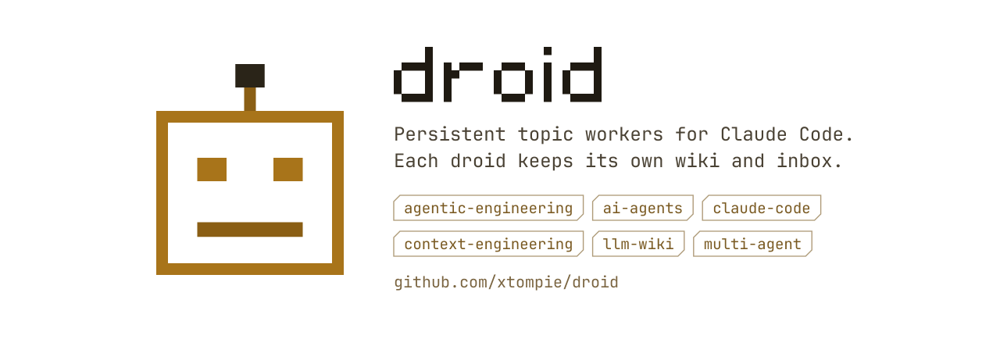
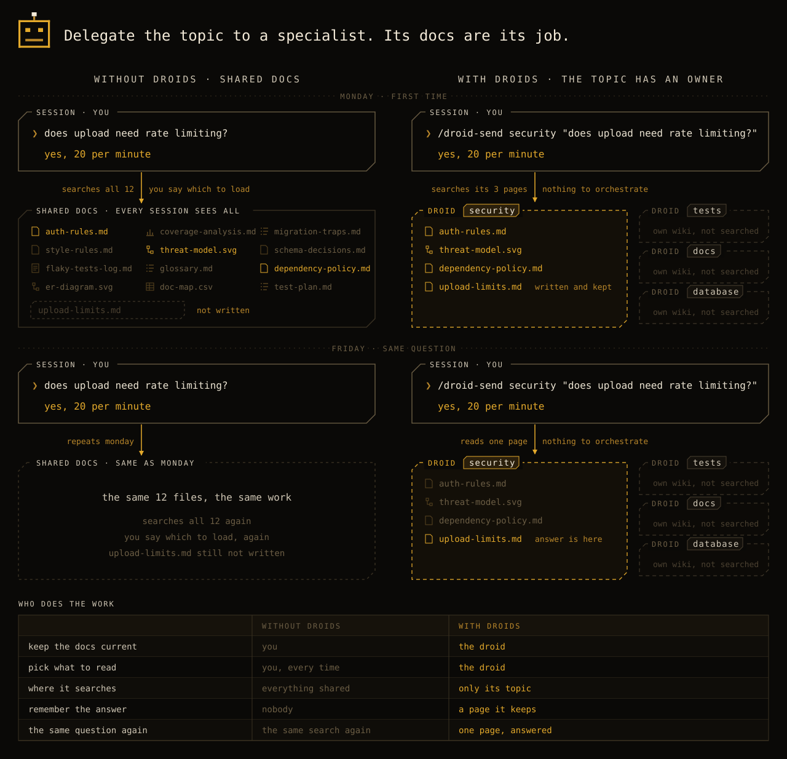
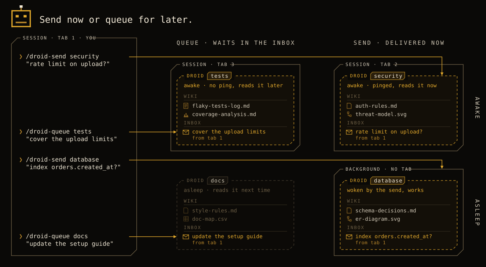

<picture>
  <source media="(prefers-color-scheme: dark)" srcset="assets/banner-dark.svg">
  
</picture>

Without droids, every new topic means a new session: you open it, load the right documents, explain where things stand, and hope it read everything. Next time you do it again.

With droids, you set up a worker once per topic. It keeps its own knowledge and context, the way a person on the team would. Work is not a shared to-do list that anyone grabs. Each droid has its own pile of tasks, because the topic is its job. You hand it work from any session. It does not matter whether the droid is running right now: the task waits in its inbox until the droid works again. When it is done, you get the answer, and the droid keeps what it learned for next time.

## Knowledge with an owner

The usual way to give an agent knowledge is to write it into shared documents and make every session read them. Then you maintain those documents forever: keep them current, keep them short, make sure the right session loads the right file.

A droid encapsulates the knowledge of its topic. It keeps it, updates it and decides what matters. You do not have to.



- **Don't know something? Ask.** `/droid-send security "Does the new upload endpoint need rate limiting?"` The droid answers from what it knows, and learns from the question.
- **Need to work on the topic yourself? Load it.** `/droid-load security` in any session, and you talk to the expert directly, with all its context.
- **Leave work for later? Queue it.** `/droid-queue security "Review the cookie flags"` waits in its inbox until it works next time.
- **Your instructions stay small.** Instead of pages of rules for every topic, one line is enough: "security questions go to the security droid".
- **Every session stays focused.** It asks the droid instead of reading everything the droid knows.

It works like a team: you do not read the security handbook before every change. You ask the person who owns security.

## Why

- A project grows into many topics: security, documentation, the database, tests. One router and one set of documents for everything gets heavy. Every session has to load the right files, and you have to check that it did.
- Reading for one topic fills the main session's context. A droid does the work in its own context, scoped to the task. You get the result, not the reading. Your main session stays clean.
- Sessions die and get compacted. Two days later nobody remembers where the migration stopped.
- Claude Code agent teams live only inside one session. Subagents start from zero every time. A droid is like a subagent that keeps what it learned.

A droid is a colleague with a memory. It looks after the context of its topic. You talk to it, or you send it a message, and it does the rest.

## Six ways to see a droid

**A crew member.** A project needs people for different things. A droid is the one who handles one of them. You hand it work, it remembers, it reports back. You lead the crew. You do not have to be the archive.

**A small wiki that thinks.** Each droid is a single-topic [LLM Wiki](https://gist.github.com/karpathy/442a6bf555914893e9891c11519de94f). The knowledge of a topic lives with the one who works on it, not in one big shared context. The droid merges what it learns into its pages and keeps them tidy.

**A context budget.** Loading everything into one session makes it slow and confused. Hand a topic to a droid and it works in its own context window. Your session gets the answer, not the reading. Like a subagent, but it keeps what it learned.

**An actor.** For programmers: a droid is an [actor](https://en.wikipedia.org/wiki/Actor_model). Private state, a mailbox, messages handled one by one. Mail waits while it sleeps.

**A run that does not end.** [Open Mercato](https://github.com/open-mercato/open-mercato) keeps the state of one task in a run folder with a plan and a handoff. A droid is a run that outlives its task. It keeps its wiki and its inbox and takes the next job.

**A pilot and a machine.** A session is the pilot: short-lived, holds the conversation in memory. A droid is the machine: identity, knowledge and pending work on disk. Pilots change. The machine keeps going.

## What a droid is

- **An ongoing responsibility**, not a task with an end: `security`, `docs`, `database`. A droid lives as long as its topic does.
- **A folder** in your repo, for example `.ai/droids/security/`.
- **A wiki** of its topic, in the [LLM Wiki](https://gist.github.com/karpathy/442a6bf555914893e9891c11519de94f) pattern: an index and linked pages. New knowledge gets merged into pages, not appended.
- **An inbox**: one file per message or task. The only fixed contract between droids.
- **A session binding**: the session that loaded it gets pings when new mail arrives.

There is no owner, no lock, no log and no state file. Continuity is the wiki and the inbox. It is plain files in git. Two people on one droid is the same as two people on one module: git shows the conflict.

## How it works


```text
.ai/droids/
  droids.md          rules for all droids
  security/          a droid you created, for example
    droid.ini        name, description, created
    droid.md         who it is and what it is responsible for
    session.ini      the session that loaded it (not in git)
    inbox/           messages and tasks
    index.md         catalog of its wiki
    auth-rules.md
    dependency-policy.md
```

- **Load a droid into a session:** `/droid-load security`. A session is the base layer. A droid is loaded on purpose.
- **Need it now? Send it:** `/droid-send security "Does the new upload endpoint need rate limiting?"`. A running droid gets a ping. A sleeping one gets the message in its inbox, and you get the command to start it.
- **Leave it a task for later:** `/droid-queue security "Review the cookie flags"`. It lands in the inbox and waits until the droid works next time.
- **Start a sleeping droid:** `claude "/droid-wake security .ai/droids/security/inbox/<file>"` in a new terminal. It loads the droid and works through its inbox, that message first. `/droid-send` prints this command for you.
- **Let it work:** `/droid-work`. It takes inbox items one by one, replies, and folds what it learned into its wiki.

## How droids get messages



Both commands write the message to the droid's inbox. `/droid-queue` stops there: the droid reads it next time it works, even if it is running right now. `/droid-send` also pings the droid. A droid loaded in a session reads it between steps. A sleeping droid gets the message in its inbox, and you get the command to start it with that message first: `claude "/droid-wake security <inbox file>"`.

## Skills

| Skill | Does |
|---|---|
| `/droid-new [name] [what it does]` | new droid, from the current conversation if no arguments |
| `/droid-clone <source> [name] [how it differs]` | new droid with the same role and wiki |
| `/droid-status` | all droids: tasks, session, description |
| `/droid-load <name>` | load a droid into this session |
| `/droid-wake <name> [inbox file]` | load a droid and work through its inbox, the given message first; how you start a sleeping droid |
| `/droid-tasks [name]` | list its inbox |
| `/droid-work [name]` | work through the inbox |
| `/droid-send <to> <message>` | send now: a running droid gets a ping; a sleeping one gets it in its inbox and you get the command to start it |
| `/droid-queue <to> <message>` | leave a message or task for later |
| `/droid-save [name]` | fold what it learned into the wiki before you stop |
| `/droid-lint [name]` | tidy the wiki |
| `/droid-destroy <name>` | remove a droid |

Only `/droid-send` and `/droid-queue` are visible to the model. The rest run when you type them, so they cost no context in normal sessions.

## Install

Paste this into Claude Code in your project:

```text
Install Droid from https://github.com/xtompie/droid. Follow INSTALL.md from that repo.
```

The agent asks where to keep droids, whether to install the skills for this project or for your user, and what to call them. Install them in the project: anyone who clones the repo gets the skills, and the droids folder makes sense to them.

To upgrade later, paste the same line with "Upgrade" instead of "Install". The agent reads the installed version and applies what changed since, from `CHANGELOG.md`.

Want the model to see every droid skill, not only send and queue? Copy the skills to `~/.claude/skills/` and remove the `disable-model-invocation` line. Your copy wins over the project one, only for you. It does not update with the repo, so copy it again after an update.

Requirements: Claude Code 2.1.310 or newer, macOS or Linux, `git`.

## Tests

```bash
tests/run.sh                          # every case once, on Haiku
tests/run.sh new --runs 3 --model sonnet
```

Each case starts a real Claude Code session (`claude -p`) in a fresh temporary project, installs the skills there with the prefix `dt` (so they do not clash with your installed `droid-*` skills), runs one command and checks the files and the answer with plain shell. They cost tokens. Cases live in `tests/cases/<id>/`: `prompt.md`, `setup.sh`, `check.sh`.

## Relies on Claude Code internals

Droids find live sessions through Claude Code's session registry in `~/.claude/sessions/` and ping them through its messaging sockets. Neither is documented. A Claude Code update can break pings and status. Files never break: the wiki and the inbox stay, and the next `/droid-work` reads them. The lookup lives in one place, `droids.md` → "Session file".

## Credits

- Andrej Karpathy, [LLM Wiki](https://gist.github.com/karpathy/442a6bf555914893e9891c11519de94f)
- [Cortex](https://github.com/xtompie/cortex), the wiki rules each droid follows
- Ideas from [Gas Town](https://github.com/steveyegge/gastown) and [MCP Agent Mail](https://github.com/Dicklesworthstone/mcp_agent_mail)
